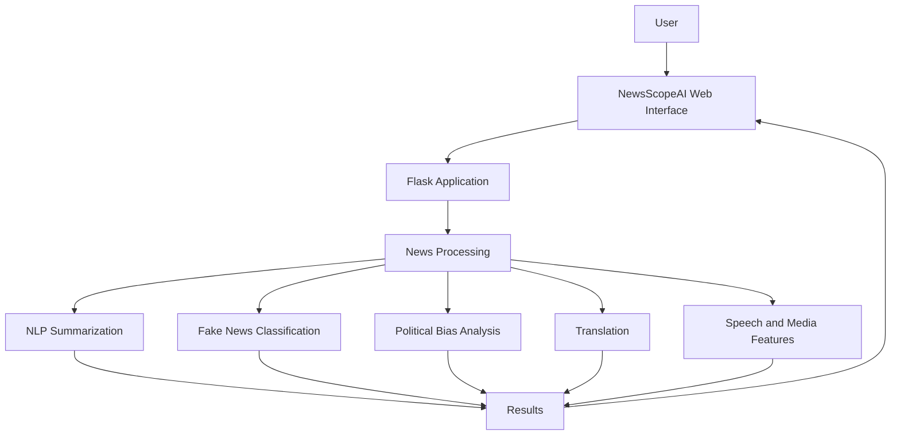

# 📰 NewsScopeAI

### AI-Powered News Intelligence Platform

NewsScopeAI is an AI-driven news analysis application designed to help users understand, evaluate, and consume news more effectively.

The platform combines natural language processing, machine learning, news credibility analysis, political bias detection, multilingual translation, and accessible media formats in a unified application.

## 📌 Navigation

[Features](#-key-features) · [Architecture](#-system-architecture) · [Tech Stack](#-technology-stack) · [Installation](#-run-locally) · [Project Structure](#-repository-structure) · [Deployment](#-deployment)

---

## ✨ Key Features

### 1. News Summarization
- Generates concise summaries of longer news articles.
- Uses Transformer-based NLP techniques.
- Helps readers quickly identify important information.

### 2. Fake News Detection
- Analyzes news content using machine learning.
- Produces credibility-related predictions.
- Helps users identify potentially misleading information.

### 3. Political Bias Analysis
- Classifies news content into political bias categories.
- Supports left, center, and right classifications.
- Provides additional context for interpreting news coverage.

### 4. Multilingual Translation
- Supports translation of news content into different languages.
- Makes information more accessible to multilingual audiences.

### 5. Voice Accessibility
- Converts text into speech using TTS technologies.
- Supports voice-oriented news consumption.
- Includes speech recognition and accessibility features.

### 6. Multimedia News
- Includes functionality for converting news into audio and video-oriented formats.
- Uses supporting speech and media-processing libraries.

---

## 🏗️ System Architecture



This is a conceptual overview of the application's major features.

---

## 🛠️ Technology Stack

| Category | Technologies |
|---|---|
| Web Interface | HTML, CSS, JavaScript |
| Backend | Python, Flask |
| NLP | Hugging Face Transformers |
| Machine Learning | scikit-learn, PyTorch |
| AI Integration | OpenAI API |
| Translation | googletrans |
| Text-to-Speech | gTTS, ElevenLabs |
| Speech Recognition | SpeechRecognition |
| Media Processing | MoviePy, OpenCV |
| Deployment | Docker, Gunicorn, Render configuration |

The table reflects technologies documented in the repository and its dependency files.

---

## 🚀 Run Locally

### Requirements

- Python and pip
- Git
- Internet access for installing dependencies
- API credentials for features that require external services

### 1. Clone the repository

```bash
git clone https://github.com/AnanyaSingh2305/NewsScopeAi.git
cd NewsScopeAi
```

### 2. Create a virtual environment

```bash
python -m venv .venv
```

Activate on Windows:

```powershell
.\.venv\Scripts\Activate.ps1
```

Activate on macOS/Linux:

```bash
source .venv/bin/activate
```

### 3. Install dependencies

```bash
python -m pip install -r requirements.txt
```

### 4. Configure environment variables

Copy `.env.example` to `.env`.

```env
FLASK_APP=run.py
FLASK_ENV=development
SECRET_KEY=replace_with_your_secret_key
OPENAI_API_KEY=replace_with_your_api_key
```

Never commit real API keys or passwords.

### 5. Start the application

```bash
python run.py
```

Open:

http://127.0.0.1:5000

The application's entry point is `run.py`.

**Note:** Installation and startup have not been independently tested for this README revision. Some features may require additional models, system dependencies, or credentials.

---

## 📁 Repository Structure

```text
NewsScopeAi/
├── app/                    # Flask application
├── static/                 # Static web assets
├── templates/              # HTML templates
├── .env.example            # Environment configuration example
├── .gitignore
├── .dockerignore
├── .renderignore
├── run.py                  # Application entry point
├── train_fake_news.py      # Fake news training script
├── requirements.txt        # Python dependencies
├── Dockerfile              # Container configuration
├── docker-compose.yml      # Docker Compose configuration
├── render.yaml             # Render configuration
├── DEPLOYMENT.md           # Deployment documentation
├── RENDER_DEPLOYMENT.md    # Render-specific instructions
└── README.md
```

---

## 🔍 How NewsScopeAI Works

### News Processing

The user provides or selects news content for analysis.

The application offers several processing features:

1. **Summarization** — Generates a shorter representation of the news content.
2. **Credibility analysis** — Applies classification techniques to assess potentially misleading information.
3. **Bias analysis** — Examines content for political orientation.
4. **Translation** — Converts content into supported languages.
5. **Accessibility** — Offers audio and speech-related capabilities.

These features help users access news in different formats and examine its content from multiple perspectives.

---

## 🧪 Machine Learning and NLP

NewsScopeAI incorporates NLP and machine-learning technologies.

### Transformer-Based Summarization

Transformer models are used to generate concise article summaries while retaining important information.

### Fake News Classification

The repository contains a dedicated training script:

`train_fake_news.py`

This supports the project's fake-news classification functionality.

### Political Bias Classification

The platform provides left, center, and right bias categories to help users understand possible political framing.

**Important:** Credibility and bias predictions are automated assessments, not independent proof that an article is true, false, or politically biased.

---

## 🐳 Deployment

The repository contains configuration for Docker and Render.

Relevant files:

- `Dockerfile`
- `docker-compose.yml`
- `render.yaml`
- `DEPLOYMENT.md`
- `RENDER_DEPLOYMENT.md`

For deployment-specific setup, refer to the existing documentation.

A successful production deployment has not been independently verified here.

---

## 📈 Project Highlights

- Developed an AI-powered news analysis application.
- Integrated summarization, credibility analysis, bias classification, and translation.
- Incorporated speech and multimedia accessibility features.
- Combined Flask-based backend development with NLP and machine-learning libraries.
- Organized the project with environment configuration and deployment support.

---

## 🔮 Future Improvements

- Real-time news aggregation
- Personalized news recommendations
- Enhanced credibility evaluation
- Improved multilingual accessibility
- Mobile-friendly user experience
- Additional deployment and automated testing

---

## 👩‍💻 Author

**Ananya Singh**

Information Science and Engineering

[GitHub](https://github.com/AnanyaSingh2305) · [LinkedIn](https://www.linkedin.com/in/ananya-singh-8934b4294/)

---

## 📬 Contact

For collaboration, project discussions, or internship opportunities:

**Email:** ananyasingh5900@gmail.com

**GitHub:** https://github.com/AnanyaSingh2305

---

⭐ If you find this project useful, consider starring the repository.
